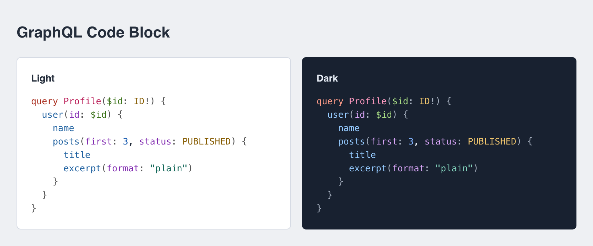

# React GraphQL Syntax Highlighter

A display-only React component that formats and highlights GraphQL. It renders a single `<pre><code>` block so you can select and copy a multiline query.

## Installation

```sh
pnpm add react-graphql-syntax-highlighter graphql
```

## Usage

```tsx
import { GraphQLCodeBlock } from 'react-graphql-syntax-highlighter';
import 'react-graphql-syntax-highlighter/style.css';

<GraphQLCodeBlock src="query Profile { viewer { id name } }" className="example-query" />;
```

`src` is the GraphQL source. Valid input is formatted before highlighting. Invalid input is displayed unchanged as plain text. The optional `className` is applied to the outer `<pre>` in both cases.

If you customized the markup with `.GraphQLCodeBlock pre` before, target `.GraphQLCodeBlock` for the outer block or `.GraphQLCodeBlock > code` for its contents.

## Theming



The stylesheet leaves the background transparent. Its default palette is for light backgrounds and switches to dark colors when the surrounding CSS sets `color-scheme: dark`. Set custom properties on the block or an ancestor to override individual colors.

```css
.example-query {
  color-scheme: light;
  --graphql-keyword: #8c2453;
}

[data-theme='dark'] .example-query {
  color-scheme: dark;
  --graphql-keyword: #ffadd2;
}
```

Available properties: `--graphql-keyword`, `--graphql-definition`, `--graphql-property`, `--graphql-attribute`, `--graphql-variable`, `--graphql-string`, `--graphql-number`, `--graphql-atom`, and `--graphql-punctuation`.

## Development

Use Node 20.19+, 22.13+, or 24 and the pnpm version in `package.json`.

```sh
pnpm install
pnpm format
pnpm lint
pnpm typecheck
pnpm test
pnpm build
```
